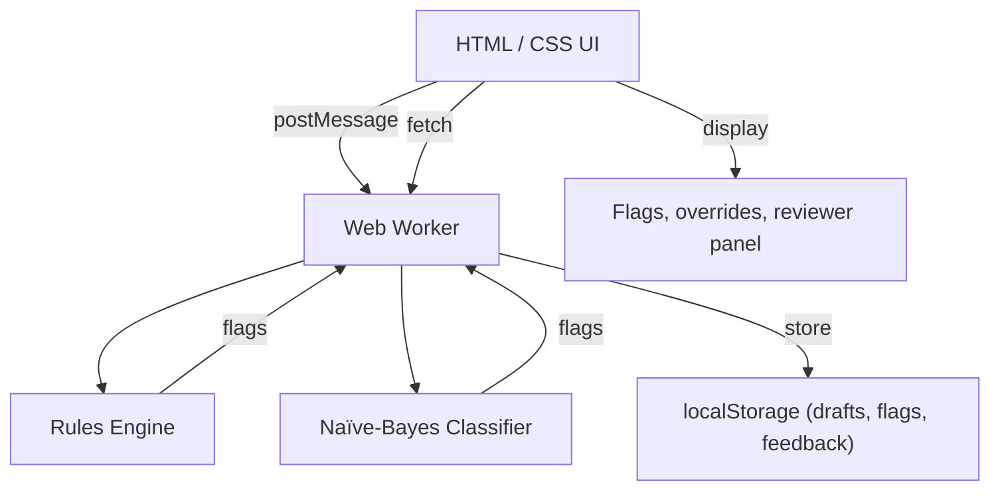

# GuideMate – Hackathon Edition

**Live demo:** https://guidemate-demo-<random>.vercel.app (replace with your Vercel URL after deployment)

## 🎯 Project vision
GuideMate is an **AI‑assisted brand‑compliance checker** that runs **entirely in the browser**. It helps content creators catch tone, factual, and accessibility issues **before a human reviewer sees the draft**. The tool combines deterministic rule‑based checks with a lightweight Naïve‑Bayes classifier, learns from user overrides, and provides an audit‑ready review workflow.

## ✨ Key features
- **Zero‑backend architecture** – all logic runs in a Web‑Worker; nothing is sent to a server unless you swap in a real LLM.
- **Brand‑specific guidelines** (glossary, tone, approved facts, accessibility rules).
- **Live feedback** with confidence scores and suggested rewrites.
- **Override & learning loop** – creators can mark false‑positives, which instantly retrains the model.
- **Reviewer UI** – list drafts, see flags, approve or reject with a reason.
- **Insights panel** – quick statistics about rejection reasons.
- **Responsive & accessible** – dark‑mode, mobile‑first layout, ARIA roles, keyboard‑only overrides.
- **Full test suite** (Jest) and CI (GitHub Actions).
- **One‑click deployment** on Vercel (static site) or GitHub Pages.

## 📐 Architecture overview


## 📦 Getting started (local development)
### Prerequisites
- **Node ≥ 20** (download from nodejs.org)
- **pnpm** (preferred) – `npm i -g pnpm`
- **Git**

### Install & run
```powershell
# Clone the repo (skip if you already have the folder)
git clone https://github.com/your‑username/guidemate-demo.git
cd guidemate-demo

# Install dependencies
pnpm install

# Start the dev server (hot‑reload)
pnpm run dev
```
Open `http://localhost:5173` in your browser.

### Build for production
```powershell
pnpm run build   # outputs to ./dist
```

## 🚀 Deployments
### Vercel (recommended)
1. Commit the `vercel.json` file (already in the repo).
2. Connect the GitHub repository on <https://vercel.com> → **New Project**.
3. Choose the repo, accept the defaults (Build Command: `pnpm install && pnpm run build`, Output Directory: `dist`).
4. Deploy – Vercel will give you a URL like `https://guidemate-demo-xxxx.vercel.app`.

### GitHub Pages (alternative)
```powershell
git push origin main   # ensure the latest build is pushed
# Enable Pages in the repo Settings → Pages → Source: main /dist
```

## 🧪 Running the test suite
```powershell
pnpm run test
```
All core modules (`text.js`, `naive‑bayes.js`, `rules‑engine.js`, `checker.js`) have > 90 % coverage.

## 🛠️ Scripts reference
| Script | Description |
|--------|--------------|
| `dev` | Starts Vite dev server (hot‑reload). |
| `build` | Produces a static `dist/` folder for production. |
| `preview` | Serves the built site locally (good for final QA). |
| `test` | Runs Jest unit tests. |
| `lint` | Runs ESLint + Prettier checks. |

## 🤝 Contributing
1. Fork the repo.
2. Create a feature branch (`git checkout -b my‑feature`).
3. Make changes, add tests, run `npm run lint`.
4. Open a Pull Request – describe the feature and reference any related issue.

## 📜 License
This project is released under the **MIT License** – feel free to reuse, remix, and ship it for any purpose.

---
### 🎉 Ready for the hackathon!
- Push your changes (`git add . && git commit -m "..." && git push`).
- Deploy to Vercel or GitHub Pages.
- Share the live URL with the judges and demonstrate the live override/learning loop.

Good luck, and enjoy building! 🚀